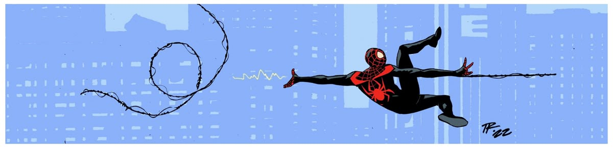
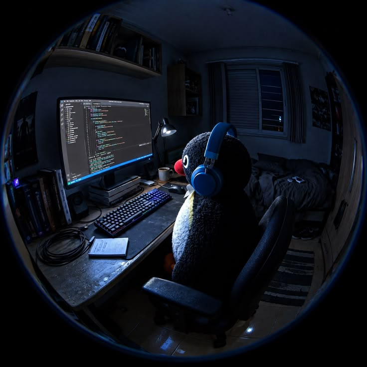
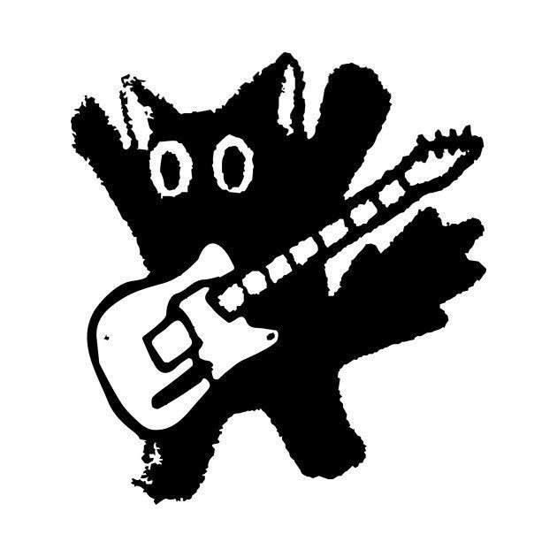

<!-- =========================================================
     KANISHK NEGI — GITHUB PROFILE README
     Replace YOUR_GITHUB_USERNAME and the image placeholders.
     ========================================================= -->

<!-- =============== HERO BANNER =============== -->

<div align="center">



<br/>

# Hi! I'm Kanishk...

### Full-Stack Developer leaning towards Backend | LLMs & Agents | Distributed Systems

<samp>Building reliable systems. Exploring intelligent agents. Shipping things that last.</samp>

<br/>

[](https://github.com/kanishkzzz)
[](https://www.linkedin.com/in/kanishk-negi-264018302/)
[](mailto:kanishk8negi@gmail.com)

</div>

---

<!-- =============== ABOUT ME =============== -->

<h2 align="center">🚀 About Me</h2>

<table>
<tr>
<td width="60%" valign="middle">

```text
Name       : Kanishk Negi
Role       : Full-Stack Engineer
Education  : B.Tech, DTU (2026)
Focus      : AI Agents, APIs, Distributed Systems
Currently  : Blogy
```

- Building scalable backend systems with Python, FastAPI, Node.js and TypeScript.
- Exploring LLM applications, RAG, tool calling and multi-agent orchestration.
- Focused on clean architecture, rigorous testing and practical AI engineering.

**Current goal:** Build reliable software that solves real problems.

</td>
<td width="40%" align="center" valign="middle">

<!-- Replace with your own transparent PNG, GIF, or pixel-art illustration -->


</td>
</tr>
</table>

---

<!-- =============== CONNECT =============== -->

<h2 align="center">Connect me on</h2>

<div align="center">

<a href="https://github.com/kanishkzzz">

</a>
&nbsp;
<a href="https://www.linkedin.com/in/kanishk-negi-264018302/">

</a>
&nbsp;
<a href="mailto:kanishk8negi@gmail.com">

</a>

</div>

---

<!-- =============== TECH STACK =============== -->

<h2 align="center">💻 Tech Stack</h2>

<h3 align="center">Languages</h3>

<div align="center">


</div>

<h3 align="center">Backend & Databases</h3>

<div align="center">


</div>

<h3 align="center">AI, Infrastructure & Tools</h3>

<div align="center">


</div>

---

<!-- =============== FEATURED PROJECTS =============== -->

<h2 align="center">⚡ Featured Projects</h2>

<table>
<tr>
<td width="50%" valign="top">

<h3 align="center">🤖 BugBeGone</h3>

<p align="center">AI PR Review & Orchestration Agent</p>

An event-driven AI agent that analyzes pull requests, retrieves relevant code context and publishes structured review results.

**Stack:** Python, FastAPI, LangGraph, RAG, ChromaDB

<p align="center">

<a href="https://github.com/kanishkzzz/PR-Review-Intelligence-Agent">

</a>

</p>

</td>
<td width="50%" valign="top">

<h3 align="center">🎟️ ArriveAll</h3>

<p align="center">High-Concurrency Ticketing Backend</p>

A ticket-booking backend focused on reliable seat reservations, distributed locks and safe transaction handling under concurrent traffic.

**Stack:** Next.js, TypeScript, PostgreSQL, Redis, Drizzle ORM

<p align="center">

<a href="https://github.com/kanishkzzz/ArriveALL">

</a>

</p>

</td>
</tr>
<tr>
<td width="50%" valign="top">

<h3 align="center">💸 Billicious</h3>

<p align="center">Transactional Expense Splitting</p>

A multi-party expense management application with transactional settlement logic, real-time synchronization and authentication.

**Stack:** Next.js, TypeScript, PostgreSQL, Supabase

<p align="center">

<a href="https://github.com/kanishkzzz/Billcious">

</a>

</p>

</td>
<td width="50%" valign="top">

<h3 align="center">🧠 What I'm Exploring</h3>

<p align="center">AI Engineering & Distributed Systems</p>

- Agent orchestration and tool calling
- Retrieval-augmented generation
- Evaluation datasets and observability
- Concurrency, retries and idempotency

</td>
</tr>
</table>

---

<!-- =============== GITHUB STATISTICS =============== -->

<h2 align="center">📊 GitHub Stats</h2>

<div align="center">


<br/><br/>


</div>

---

<!-- =============== ACTIVITY GRAPH =============== -->

<h2 align="center">📈 Activity Graph</h2>

<div align="center">


</div>

---

<!-- =============== FOOTER ART =============== -->

<div align="center">

<!-- Optional replaceable footer illustration -->


<br/>

<samp>Clean code. Reliable systems. Continuous learning.</samp>

<br/><br/>


</div>
